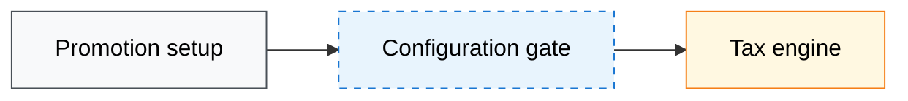

# Crispy Mermaid

A useful diagram answers one visual question at a glance. The reader should see the scope, follow the main path, distinguish boundaries and exceptions, and understand the consequence without decoding decoration.

When the diagram belongs to a document, preserve its artifact owner and apply `crispy-doc` to the surrounding reading path. This skill owns the visual grammar.

## Define the visual question

Write one sentence that states what the diagram must reveal. Name the audience and the decision or understanding the diagram supports. Split the diagram when the question contains two independent views.

Choose the form that matches the question:

| Question | Mermaid form |
|---|---|
| Which systems, phases, or owners connect? | `flowchart` |
| What happens over time between participants? | `sequenceDiagram` |
| Which states and transitions are possible? | `stateDiagram-v2` |
| Which entities and relationships define the data? | `erDiagram` or `classDiagram` |

Use one form per diagram. A flowchart should not imitate a sequence diagram by adding time to every node.

## Separate overview from detail

Use an overview for boundaries, major phases, and handoffs. Use detail diagrams for the systems and decisions inside one phase. Do not force both levels into one canvas.

For a system map, group the overview into ordered subgraphs such as setup, discovery, checkout, fulfillment, invoicing, accounting, and returns. Connect the subgraphs along the primary path. In a detail view, show the concrete services and branches within one boundary. Keep the same system names, phase numbers, classes, and connector meanings across both views.

The overview and detail views should complement each other. The overview answers where the work moves. The detail view answers how one phase works.

## Establish the reading direction

Choose direction from the dominant reading path:

- Use `LR` for a short linear chain or a phase detail.
- Use `TB` for an overview, a branching architecture, or a diagram with several horizontal phase lanes.
- Set `direction LR` inside a subgraph when the overall diagram runs top to bottom but each phase runs left to right.

Place the main path on one clean axis. Put secondary branches near the node that creates them. Avoid long return edges, crossings, and alternating directions. If layout work starts to dominate the source, split the diagram.

## Build boundaries and labels

Use subgraphs for real boundaries such as lifecycle phases, ownership, deployment scope, trust zones, or marketplaces. Name the boundary and its scope. Do not use a subgraph as a decorative frame.

Give every node a stable Mermaid identifier and a reader facing label. For architecture maps, use the system or actor as the first line and one responsibility or outcome below it. Keep labels to two or three short lines. Prefer concrete verbs such as `Stores promotion config`, `Allocates benefit`, or `Returns tax per line`.

Use phase numbers only when the surrounding walkthrough uses the same numbers. Expand acronyms in the document or glossary. Keep official system names unchanged.

## Give connectors one meaning

Use a small connector vocabulary and apply it consistently:

| Connector | Meaning |
|---|---|
| `-->` | Primary required flow, call, handoff, or state transition |
| `-. label .->` | Optional, exceptional, bypass, or absence path |
| `~~~` | Visual alignment only, with no relationship |

Build an edge ledger before writing Mermaid. For each proposed system edge, record the exact supplied fact or authoritative source that names both endpoints and their relationship. Draw only ledgered system edges. Record stage order separately and render it only as a subgraph edge, such as `SETUP --> CHECKOUT`. If no source names a handoff from the last system in one phase to the first system in the next, leave those systems unconnected. Label an edge when its payload, condition, decision, or failure mode matters. Use a noun phrase or short condition. Use `~~~` only for alignment. A reader should be able to explain every visible edge and cite its basis.

## Use semantic styling

Style meaning, not identity. Define a small palette for categories that matter to the question, such as shared systems, changed configuration, external dependencies, blocked paths, marketplace branches, or inactive outcomes. Reuse those classes across related diagrams.

Assign every node exactly one declared semantic class when the diagram uses a class taxonomy. Unclassified nodes create accidental meaning. Use both fill and stroke differences so color is not the only signal. Keep text contrast high and default nodes quiet. Reserve saturated colors for the distinction the reader must notice. Avoid a separate color for every service.

Declare `classDef` rules together at the bottom of the diagram. The following neutral palette is a starting point, not a required taxonomy:

## Control density

Keep only information needed to answer the visual question. Move implementation detail, evidence, and caveats into the walkthrough. Split the view when node labels need paragraphs, branches cannot stay near their source, or the reader must scan the whole canvas to follow one path.

Use repeated compact diagrams when a document walks through phases. Reuse the same direction and style classes so the reader learns the visual language once. Do not repeat an identical diagram or reproduce the same information in prose.

## Place the diagram in the document

Introduce the diagram with one sentence that states its question or purpose. Follow it with the consequence, decision, or phase walkthrough. Do not narrate every box and arrow.

For a large architecture document, use this sequence when it fits the artifact owner:

1. One global overview with phase boundaries and major handoffs.
2. A compact table that identifies the footprint, change, or risk by phase.
3. One detail diagram before each phase walkthrough that needs it.
4. A separate table for failure semantics, ownership, or other dense reference material.

## Validate the rendered result

Render the diagram in the target host when possible. Otherwise, use the project renderer or Mermaid CLI. Fix every syntax error, then inspect the rendered result for clipped labels, unreadable contrast, crossing edges, unexplained classes, misleading proximity, and excessive whitespace. Source that parses but renders poorly is not complete.

Verify the diagram against the prose and known facts. Every node, edge, phase number, scope label, and style category must agree with the document. Never invent a system relationship to improve the layout.

## Completion criteria

- [ ] The diagram answers one stated visual question for a known audience.
- [ ] The Mermaid form and direction match the information.
- [ ] Overview and detail are separated when both are needed.
- [ ] Every boundary, node, connector, label, and class carries a defined meaning.
- [ ] The main path is easy to follow without edge crossings or layout arrows.
- [ ] Labels are compact, concrete, and consistent with the document.
- [ ] Every system edge has an explicit factual basis, and phase order never invents an endpoint handoff.
- [ ] Styling is semantic, restrained, legible, and consistent across related diagrams.
- [ ] The surrounding prose introduces the diagram and explains its consequence without restating it.
- [ ] The rendered diagram is valid, readable, and faithful to known facts.
